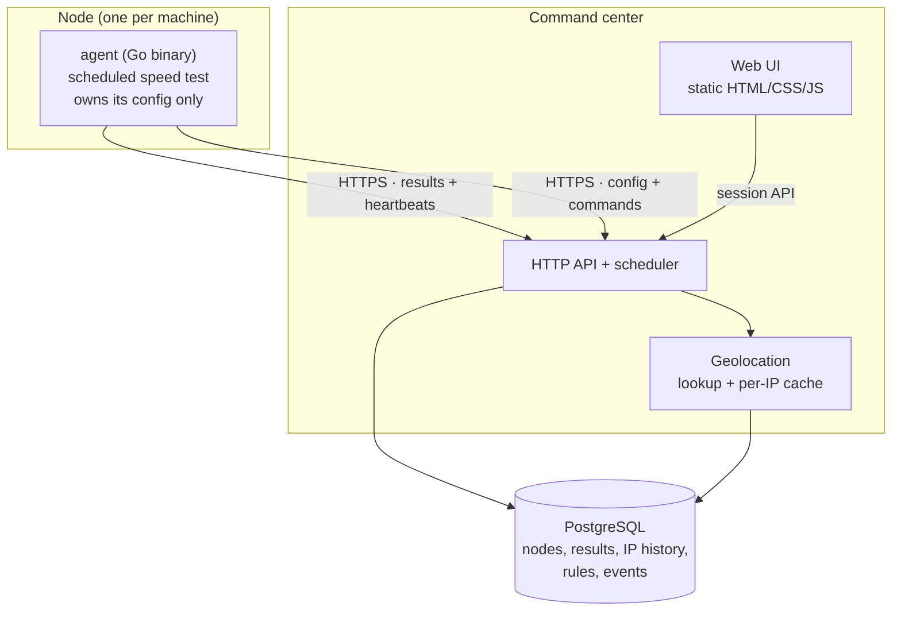

# Architecture

Speedtest measures the real speed of every internet connection you own, around
the clock. Small **agents** on your machines run a speed test on a schedule and
report to one **command center**, which stores every result, remembers the
public IP each node used and where it is, and serves a web **UI**.

The system has two processes, both built from this module
(`github.com/jooservices/speedtest`, Go 1.27):

- `cmd/agent` — the node agent, one per machine.
- `cmd/center` — the command center, one per deployment.

There is no WAN or load-balancer concept. Every node is independent and knows
only its own configuration (name, expected download/upload, schedule, threads).
It never knows or cares what it is attached to; "WAN" is only a label the owner
chooses.

## Component diagram

## Agent (node)

The agent is a small single binary running the speed test program (Ookla CLI by
default) bound to the right network interface. On its schedule it:

1. Runs a speed test and captures download, upload, latency, jitter, loss and
   the public IP it measured against.
2. Reports each result to the command center over HTTPS using its own
   long-lived node credential.
3. Sends heartbeats so the center knows it is alive, and polls for commands
   (run now, pause, resume, update configuration).

A node knows only its own configuration. The center coordinates test offsets so
tests do not overlap and skew a combined measurement; the node never models its
peers or a WAN.

## Command center

The command center is the single API and UI host. It receives results, stores
them, resolves the geolocation of every new public IP once and caches it,
computes statistics and alerts, and serves the web UI. Its responsibilities are
defined by the OpenAPI contract — see [api.md](api.md) and
[openapi.yaml](openapi.yaml) for the endpoint and data-model details rather
than repeating them here.

## Database

PostgreSQL (the shared Workspaces service) is the only store. Three databases
per environment keep real data safe during development:

| Database | Purpose |
|---|---|
| `speedtest` | Live data; never deleted or wiped. |
| `speedtest_test` | Tests; wiped on every test run. |
| `speedtest_wt<id>` | One per ticket worktree. |

The schema (nodes, results, IP history, alert rules and events) is applied by
migrations in `migrations/`; see [development.md](development.md) for
provisioning and the safety checks.

## Geolocation

The center looks up the geolocation of every new public IP once and remembers
it, so the same address is never resolved twice. Lookups use the MaxMind
GeoLite2 City + ASN offline database first (free, no rate limit), with a free
web service as fallback; results are cached per IP. Unavailable lookups are
`null`, never fabricated coordinates.

## UI

The web UI is plain HTML, CSS and JavaScript under `ui/` with no build step and
no framework; charts use a small in-browser SVG kit so the preview makes no
external requests. It is a complete, clickable preview running on generated
sample data and persisted to the browser's local storage. The Go backend is
still a scaffold (it loads configuration only); the UI and API are joined in
later tickets. See [ui-decisions.md](ui-decisions.md) for the design decisions
and open questions.
